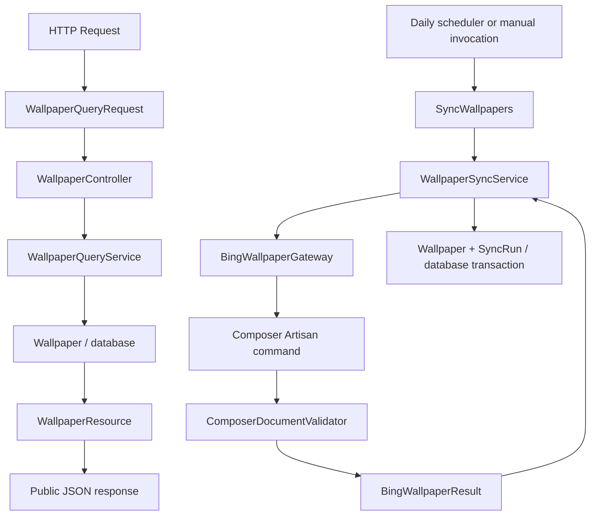

# Application architecture

The API is a small Laravel monolith. HTTP and console entry points share
application services; services use Eloquent models for persistence and a Bing
integration for external metadata. There is no additional repository layer.

## Responsibilities

| Component | Responsibility |
| --- | --- |
| `Http/Requests/WallpaperQueryRequest` | Query-only input, query-mode validation, public validation details. |
| `Http/Controllers/WallpaperController` | Invoke the query service and assemble response metadata. |
| `Http/Resources/WallpaperResource` | Explicit public fields and their wire-format names. |
| `Http/Responses/ApiErrorResponse` | Safe error envelopes and allowlisted validation messages. |
| `Http/Middleware/NormalizeApiErrors` | Normalize API error responses, including direct route responses. |
| `Console/Commands/SyncWallpapers` | Command input, exit codes, safe synchronization logs and output. |
| `Services/WallpaperQueryService` | Exact/range reads, public projection and stable ordering. |
| `Services/WallpaperSyncService` | Synchronization orchestration, idempotent writes, transaction and audit outcomes. |
| `Integrations/Bing/BingWallpaperGateway` | In-process Composer Artisan call and isolated output buffer. |
| `Integrations/Bing/ComposerDocumentValidator` | Complete v1 JSON and exit-code validation. |
| `Integrations/Bing/BingWallpaperResult` | Typed carrier for validated metadata and integration failure categories. |
| `Models/Wallpaper`, `Models/SyncRun` | Persistence mapping and calendar-date/UTC timestamp conversion. |
| `Support/CalendarDate` | Source-independent canonical calendar-date validation. |
| `bootstrap/app.php` | Routing, middleware and centralized API exception handling. |

## Read and synchronization paths

Controllers and commands do not build database queries. Services do not accept
HTTP requests or return HTTP responses. The query service can be called without
an HTTP request through `forDate()` or `between()` and rejects invalid dates or
reversed ranges from other callers as well. Request-specific error precedence
and response details remain at the HTTP boundary.

The integration does not access the database. The external lookup completes
before the synchronization transaction begins. A found wallpaper and its success
audit commit together. A persistence failure rolls back the transaction before
an independent failure audit is attempted. Each lookup gets its own audit;
repeated successful lookups upsert the same source identity.

## Data semantics

`source_date` and `requested_date` are calendar `DATE` values, stored as
`YYYY-MM-DD` without timezone conversion. Retrieval and synchronization
timestamps are UTC instants. Models normalize date writes consistently on SQLite
and PostgreSQL; direct ingestion upserts already supply canonical dates.

Public resources are an explicit allowlist. Internal source IDs, original JSON,
schema versions and synchronization records are not exposed. Original JSON value
types are preserved by the integration and ingestion service.

## API errors and logging

API exceptions are handled centrally, independently of `APP_DEBUG`. Unexpected
exceptions return a fixed `INTERNAL_ERROR` JSON response and HTTP 500. Known HTTP
errors retain their status and headers such as `Allow` and `Retry-After`, but do
not expose exception messages. Existing query-validation details are rebuilt
from allowlisted public fields and codes, never arbitrary supplied messages.
The same formatter runs at the API middleware boundary and after exception
rendering, covering explicit responses and exceptions with custom render methods.
Non-API requests retain Laravel's exception behavior.

The fallback constructs a response directly and the error formatter produces
the JSON envelope without resolving Laravel's response factory or initializing
a database-backed session. Reportable API exceptions log
only a fixed message, error code and exception class; SQL, bindings, request
values, exception messages and stack traces are excluded. This replaces the
default report for those exceptions to avoid logging them twice. Laravel's
normally unreported HTTP and validation exceptions remain unreported.

Production must still disable debugging. The API fallback operates after the
application has booted; web-server, PHP startup and application-bootstrap failures
must be handled by deployment configuration.

## Runtime and tests

The default cache is `file`, and the default queue connection is `sync`, matching
the example configuration and avoiding nonexistent cache/job tables. Environment
overrides remain supported; selecting a database cache or queue requires the
corresponding schema and operational setup.

The daily schedule retains its named persistent file-cache overlap lock and
previous-day UTC behavior. This assumes one scheduler host with persistent
storage. Multi-instance scheduling and shared locking are deployment decisions,
not provided by this refactor.

Unit tests cover calendar rules and Composer protocol validation. Feature tests
cover the real installed command with a fake provider, services, persistence,
scheduling, HTTP contracts and sanitized exceptions. The test base checks the
dedicated connection before database traits can migrate; PostgreSQL tests require
`wallpaper_api_test`. CI covers SQLite and PostgreSQL 18 on PHP 8.4.

## Extension boundaries

Only Bing is implemented. When another source is actually added, introduce a
shared provider contract and normalized result at the integration boundary, then
reuse the synchronization transaction. Source-specific protocol rules stay in
each integration. Add filters to the request and query service together when
their public contract is agreed. Authentication belongs at the HTTP boundary.

Repositories, provider registries, asynchronous jobs and additional abstraction
layers should be introduced only when a concrete feature requires them.
