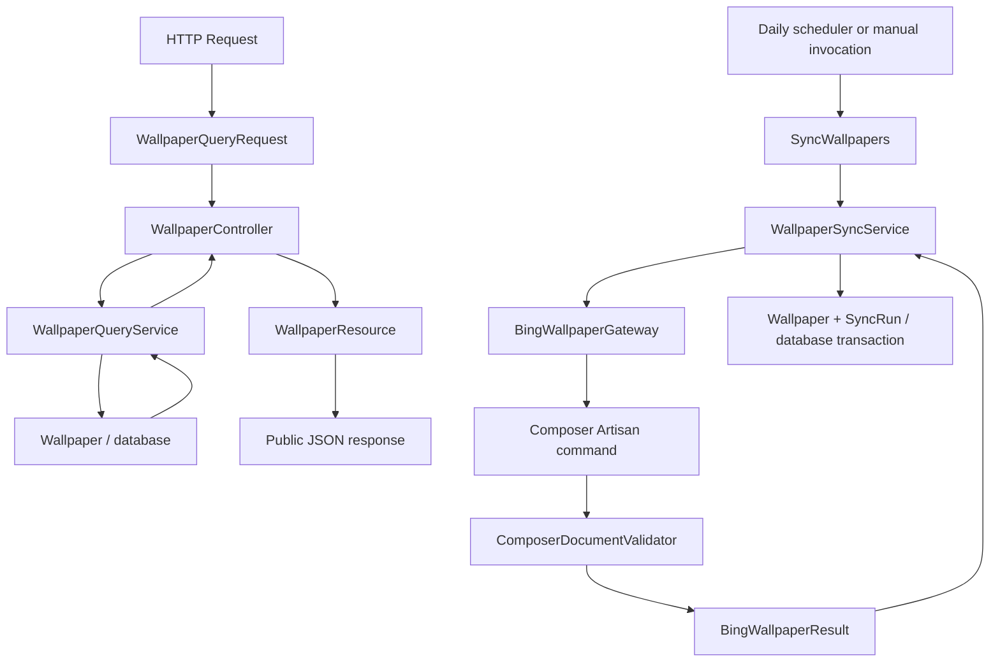
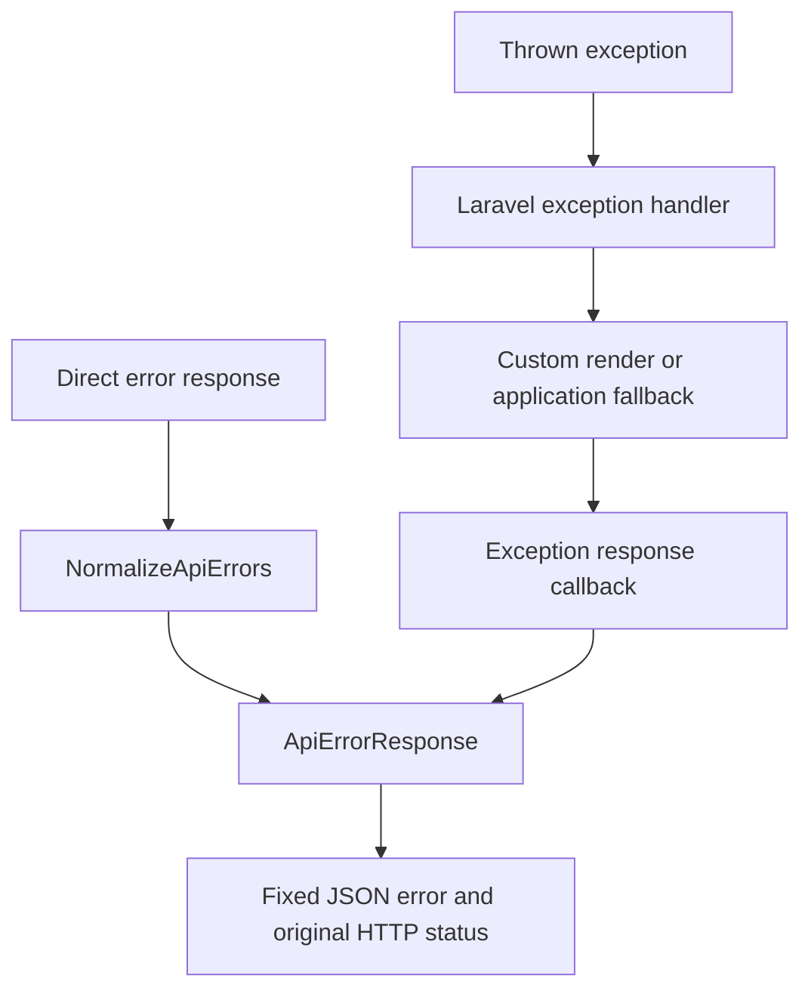

# Architecture and feature map

The API is a small Laravel 13 monolith. HTTP and console entry points share
application services; services use Eloquent models for persistence and a Bing
integration for external metadata. There is no additional repository layer.
This document describes implemented behavior. Proposals and schedules belong
in issues, PRs or the private Project.

## Find code by feature

| Feature | Entry points and implementation | Tests |
| --- | --- | --- |
| Exact-date and date-range queries | [routes/api.php](../routes/api.php) → [WallpaperController](../app/Http/Controllers/WallpaperController.php) → [WallpaperQueryService](../app/Services/WallpaperQueryService.php) | [WallpaperQueryTest](../tests/Feature/WallpaperQueryTest.php), [WallpaperQueryServiceTest](../tests/Feature/WallpaperQueryServiceTest.php) |
| Input and calendar rules | [WallpaperQueryRequest](../app/Http/Requests/WallpaperQueryRequest.php), [CalendarDate::isCanonical](../app/Support/CalendarDate.php) | [CalendarDateTest](../tests/Unit/CalendarDateTest.php), WallpaperQueryTest |
| Public JSON fields | [WallpaperResource::toArray](../app/Http/Resources/WallpaperResource.php), [v1 contract](contracts/v1.md) | WallpaperQueryTest, [ContractFixturesTest](../tests/Unit/ContractFixturesTest.php) |
| Synchronization and auditing | [SyncWallpapers::handle](../app/Console/Commands/SyncWallpapers.php) → [WallpaperSyncService::sync](../app/Services/WallpaperSyncService.php) | [SyncWallpapersTest](../tests/Feature/SyncWallpapersTest.php) |
| Composer invocation and protocol | [BingWallpaperGateway::fetch](../app/Integrations/Bing/BingWallpaperGateway.php), [ComposerDocumentValidator::validate](../app/Integrations/Bing/ComposerDocumentValidator.php), [BingWallpaperResult](../app/Integrations/Bing/BingWallpaperResult.php) | [BingWallpaperGatewayTest](../tests/Feature/BingWallpaperGatewayTest.php), [ComposerDocumentValidatorTest](../tests/Unit/ComposerDocumentValidatorTest.php) |
| Daily scheduling and overlap prevention | [routes/console.php](../routes/console.php), [daily synchronization](operations/daily-sync.md) | [WallpaperScheduleTest](../tests/Feature/WallpaperScheduleTest.php) |
| Tables, calendar dates and UTC instants | [Migrations](../database/migrations), [Wallpaper](../app/Models/Wallpaper.php), [SyncRun](../app/Models/SyncRun.php) | [PersistenceTest](../tests/Feature/PersistenceTest.php) |
| Safe errors and logs | [bootstrap/app.php](../bootstrap/app.php), [NormalizeApiErrors](../app/Http/Middleware/NormalizeApiErrors.php), [ApiErrorResponse](../app/Http/Responses/ApiErrorResponse.php) | [ApiExceptionTest](../tests/Feature/ApiExceptionTest.php) |
| CORS, request limits and broad queries | [CORS configuration](../config/cors.php), [AppServiceProvider](../app/Providers/AppServiceProvider.php), [routes/api.php](../routes/api.php), [public API controls](operations/public-api.md) | [PublicApiHardeningTest](../tests/Feature/PublicApiHardeningTest.php) |
| Test databases and CI | [tests/TestCase.php](../tests/TestCase.php), [phpunit.xml](../phpunit.xml), [CI](../.github/workflows/ci.yml) | [TestDatabaseSafetyTest](../tests/Feature/TestDatabaseSafetyTest.php) |
| Production packaging and release gates | [Dockerfile](../Dockerfile), [docker](../docker), [deployment runbook](operations/deployment.md), [release checklist](release.md) | [Container smoke checks](../scripts/smoke-container.sh), [Larastan configuration](../phpstan.neon), CI |
| Repository file and workflow guards | [.gitignore](../.gitignore), [CI](../.github/workflows/ci.yml) | [LegacyArchiveGuardTest](../tests/Feature/LegacyArchiveGuardTest.php) |
| Health check `/up` | [bootstrap/app.php](../bootstrap/app.php) | [HealthTest](../tests/Feature/HealthTest.php) |

Navigation does not replace reading the implementation and its callers.

## Responsibilities

| Component | Responsibility |
| --- | --- |
| `Http/Requests/WallpaperQueryRequest` | Query-only input, query-mode validation, public validation details. |
| `Http/Controllers/WallpaperController` | Invoke the query service and assemble response metadata. |
| `Http/Resources/WallpaperResource` | Explicit public fields and their wire-format names. |
| `Http/Responses/ApiErrorResponse` | Safe error envelopes and allowlisted validation messages. |
| `Http/Middleware/NormalizeApiErrors` | Normalize API error responses, including direct route responses. |
| `Console/Commands/SyncWallpapers` | Command input, exit codes, safe synchronization logs and output. |
| `Services/WallpaperQueryService` | Exact/range reads, public projection and stable ordering. |
| `Services/WallpaperSyncService` | Synchronization orchestration, idempotent writes, transaction and audit outcomes. |
| `Integrations/Bing/BingWallpaperGateway` | In-process Composer Artisan call and isolated output buffer. |
| `Integrations/Bing/ComposerDocumentValidator` | Complete v1 JSON and exit-code validation. |
| `Integrations/Bing/BingWallpaperResult` | Typed carrier for validated metadata and integration failure categories. |
| `Models/Wallpaper`, `Models/SyncRun` | Persistence mapping and calendar-date/UTC timestamp conversion. |
| `Support/CalendarDate` | Source-independent canonical calendar-date validation. |
| `bootstrap/app.php` | Routing, middleware and centralized API exception handling. |

## Read and synchronization paths

Controllers and commands do not build database queries. Services do not accept
HTTP requests or return HTTP responses. The query service can be called without
an HTTP request through `forDate()` or `between()` and rejects invalid dates or
reversed ranges from other callers as well. Request-specific error precedence
and response details remain at the HTTP boundary.

The integration does not access the database. The external lookup completes
before the synchronization transaction begins. A found wallpaper and its success
audit commit together. A persistence failure rolls back the transaction before
an independent failure audit is attempted. Each lookup gets its own audit;
repeated successful lookups upsert the same source identity.
Public queries read only the database: they neither call Bing nor create audits.
Synchronization stores metadata and original JSON; it does not download images
or automatically commit to Git. The installed integration version is recorded
in [composer.lock](../composer.lock); protocol fields belong to the
[v1 contract](contracts/v1.md).

| Integration result or failure | Wallpaper writes | Audit outcome |
| --- | --- | --- |
| `found` | Upsert by source identity, in the success-audit transaction | `success` |
| `not_found` | None | `not_found` |
| Upstream error, command failure or invalid protocol | None | `failed`, with a fixed safe classification |
| Transaction persistence failure | Rolled back | Attempt `PERSISTENCE_FAILURE` outside the transaction |
| Failure audit also cannot be saved | No partial transaction writes retained | Command logs `AUDIT_UNAVAILABLE` and exits with failure |

## Data semantics

`source_date` and `requested_date` are calendar `DATE` values, stored as
`YYYY-MM-DD` without timezone conversion. Retrieval and synchronization
timestamps are UTC instants. Models normalize date writes consistently on SQLite
and PostgreSQL; direct ingestion upserts already supply canonical dates.

Public resources are an explicit allowlist. Internal source IDs, original JSON,
schema versions and synchronization records are not exposed. Original JSON value
types are preserved by the integration and ingestion service.

## API errors and logging

API exceptions are handled centrally, independently of `APP_DEBUG`. Unexpected
exceptions return a fixed `INTERNAL_ERROR` JSON response and HTTP 500. Known HTTP
errors retain their status and headers such as `Allow` and `Retry-After`, but do
not expose exception messages. Existing query-validation details are rebuilt
from allowlisted public fields and codes, never arbitrary supplied messages.
The same formatter runs at the API middleware boundary and after exception
rendering, covering explicit responses and exceptions with custom render methods.
Non-API requests retain Laravel's exception behavior.

Public reads use the framework CORS middleware and a named per-IP rate limiter.
Both query modes share the budget; preflight requests bypass it. See
[public API controls](operations/public-api.md) for environment settings, cache
and proxy assumptions, safe 429 responses and broad-query resource limitations.

The fallback constructs a response directly and the error formatter produces
the JSON envelope without resolving Laravel's response factory or initializing
a database-backed session. Reportable API exceptions log
only a fixed message, error code and exception class; SQL, bindings, request
values, exception messages and stack traces are excluded. This replaces the
default report for those exceptions to avoid logging them twice. Laravel's
normally unreported HTTP and validation exceptions remain unreported.
Anonymous exception classes use their parent type in logs because PHP embeds
source paths in anonymous class names.

Production must still disable debugging. The API fallback operates after the
application has booted; web-server, PHP startup and application-bootstrap failures
must be handled by deployment configuration.

## Runtime and tests

The default cache is `file`, and the default queue connection is `sync`, matching
the example configuration and avoiding nonexistent cache/job tables. Environment
overrides remain supported; selecting a database cache or queue requires the
corresponding schema and operational setup.

The daily schedule retains its named persistent file-cache overlap lock and
previous-day UTC behavior. This assumes one scheduler host with persistent
storage. Multi-instance scheduling and shared locking are deployment decisions,
not provided by the application. See [daily synchronization](operations/daily-sync.md)
for the schedule, date selection, locks and recovery procedures.

Unit tests cover calendar rules and Composer protocol validation. Feature tests
cover the real installed command with a fake provider, services, persistence,
scheduling, HTTP contracts and sanitized exceptions. The test base checks the
dedicated connection before database traits can migrate; PostgreSQL tests require
`wallpaper_api_test`. CI covers SQLite and PostgreSQL 18 on PHP 8.4 and 8.5.
It also runs Larastan level 5, dependency audit and real production-container
HTTP smoke tests with PostgreSQL. The image runs non-root and packages production
dependencies only; it starts no scheduler and performs no automatic migration.
See [contributing](../CONTRIBUTING.md#verification) for isolated test database
configuration and verification evidence.

## Documentation maintenance

Update the owning reference in the same PR when responsibilities, interfaces,
execution paths, states, compatibility or failure behavior change. Check source
links and test evidence. Internal implementation changes that preserve these
contracts do not require a design-document update.

Maintain each fact in one place and link to it elsewhere. Reference files and
named symbols instead of volatile line numbers or copied implementations.
Describe current behavior; keep unimplemented designs in issues or PRs. Split
out a new module reference only when needed, and link it from this map.

[Code style](code-style.md) owns naming and readability rules; the
[v1 contract](contracts/v1.md) owns protocol fields; [contributing](../CONTRIBUTING.md)
owns development and review requirements.

## Extension boundaries

Only Bing is implemented. When another source is actually added, introduce a
shared provider contract and normalized result at the integration boundary, then
reuse the synchronization transaction. Source-specific protocol rules stay in
each integration. Add filters to the request and query service together when
their public contract is agreed. Authentication belongs at the HTTP boundary.

Repositories, provider registries, asynchronous jobs and additional abstraction
layers should be introduced only when a concrete feature requires them.
